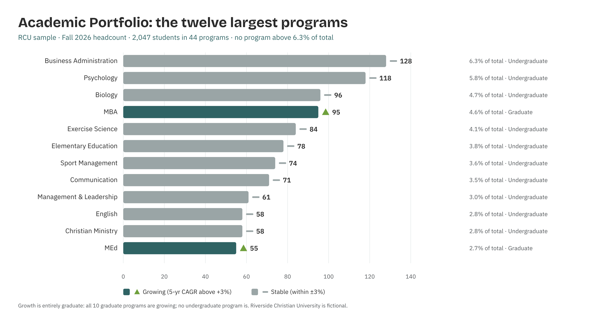

# Academic Portfolio Analyst

*Higher Ed AI Cookbook · Recipe · Free to use*

A reusable AI recipe that turns an institution's program-enrollment export into a portfolio health read: which programs anchor the institution, which are quietly declining, where concentration risk sits, and what to do about it — with every recommendation labelled by how much you should trust it.

## What this recipe does

You give an AI assistant your program-enrollment history and the agent instructions in this recipe. It returns a five-tab workbook a president or provost can act on:

- **Health Scorecard** — every program with a traffic-light trend, tier, and share of total enrollment.

- **Trend Analysis** — five-year trajectories, on-campus/online split, net change.

- **Risk Assessment** — concentration risk, declining-program severity, and portfolio-level signal.

- **Recommendations** — Grow / Maintain / Restructure / Explore / Sunset-review, each tagged research-backed, industry-practice, or analyst-judgment.

- **Sources & Methodology** — every rule, threshold, and limit written down so a skeptical academic audience can check the work.

## Who it's for

Provosts, chief academic officers, institutional-research staff, and boards at small colleges that can't staff a dedicated portfolio-analytics function. It's built for institutions with a few dozen programs, not enterprise catalogs.

## What's in the recipe

- **README** (this file) — orients a human, configures the agent, onboards a contractor.

- **Agent Instructions** — the prompt you paste into the AI tool.

- **Sample Output workbook** — a fully worked example on a fictional institution, so you see the finished shape.

- **Input Template** — a blank enrollment sheet with the expected columns, accepted header aliases, and an example row.

## How to run it

**1. Export program enrollment from your SIS.**

**2. Shape it** using the Input Template — one row per program per year. Fill what you have; blanks are fine.

**3. Open** your AI assistant, paste the Agent Instructions, and attach your filled template.

**4. Review** the workbook it returns against the Sample Output. Sanity-check the numbers before circulating.

**5. Decide** — take it to governance. The recipe is scaffolding for a human decision, not the decision.

## Configuration — the knobs that make it yours

Defaults are set for a small institution. Override in the Input Template's Config tab if your scale differs:

- Tier bands (headcount): Tier 1 ≥50 · Tier 2 20–49 · Tier 3 8–19 · Tier 4 \<8.

- Trend band: Growing / Declining at ±3% five-year CAGR.

- Concentration flag: a single program ≥15% of total enrollment.

- Scope: which populations to exclude (non-degree, dual-enrollment, K-12).

## What it deliberately does NOT do

- **It doesn't decide.** Grow/sunset calls belong to faculty governance and cabinet.

- **It doesn't assert financial viability** without your financial data. Enrollment size is not profitability. Add net-tuition-per-program data to unlock the contribution-margin view.

- **It doesn't predict individual students.** Analysis stays at the program-portfolio level.

- **It doesn't rename your data silently.** Unrecognized columns are flagged for you, not guessed.

## /help

If you're holding this recipe with no author in the room, here's the orientation:

**help —** what this is: a portfolio-health recipe that reads an enrollment export and returns an assessment workbook.

**help inputs —** what it needs: program-level enrollment by year (the Input Template shows the shape).

**help outputs —** what it gives: a five-tab workbook; the human-legible source of truth is that workbook, not any hidden state.

**help trust —** how far to lean on it: recommendations are labelled \[R\]/\[I\]/\[J\]; the Sources & Methodology tab shows every rule. It assembles and flags — it does not certify.

Built by Renee Handy · Higher Ed AI Cookbook · build 2026-07. Before you trust this agent with a real decision, find a competent human — an IR analyst, provost, or accreditation-fluent colleague — and have them check the read against your institution's reality. An orphaned agent should point you at a person, not at itself.

License: CC BY-NC-SA 4.0. Free to use and adapt for noncommercial purposes, including at your own institution. Commercial / white-label rights: contact the Cookbook. Build 2026-07. Sample data is fictional.

## Sample output

---

## Files in this recipe

- [`APA_Agent_Instructions.docx`](APA_Agent_Instructions.docx)
- [`APA_Input_Template.xlsx`](APA_Input_Template.xlsx)
- [`APA_README.docx`](APA_README.docx)
- [`APA_Sample_Output.xlsx`](APA_Sample_Output.xlsx)

- [`fig_01_academic_portfolio.png`](fig_01_academic_portfolio.png)

*This page is generated from the README `.docx`, which remains the source of truth.*
