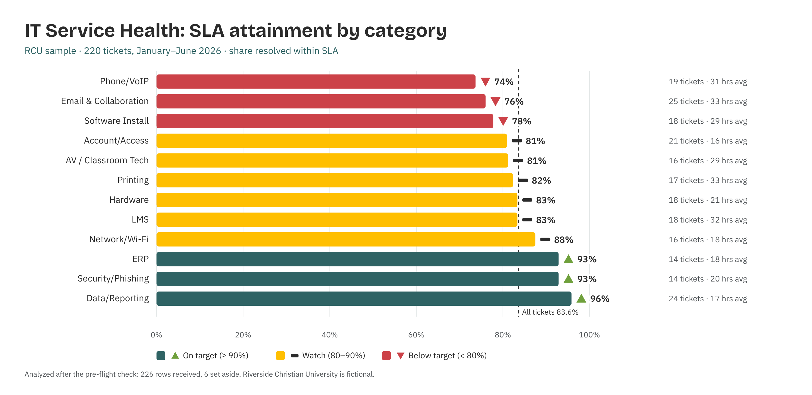

# IT Service Health Analyst

*Higher Ed AI Cookbook · Recipe · Free to use*

A reusable AI recipe that turns a help-desk ticket export into a service-health read: which categories and teams are meeting SLA, where volume concentrates, how attainment trends month to month — with every recommendation labelled by how much you should trust it.

## What this recipe does

You give an AI assistant your ticket export and the agent instructions in this recipe. It returns a workbook a CIO or help-desk lead can act on:

- Service Health Scorecard — every category with ticket volume, SLA attainment, average resolution time, and a traffic-light status.

- SLA by Priority & Team — attainment and resolution time by P1–P4 and by team, to locate the gap.

- Volume Trend — monthly ticket volume and SLA attainment, to catch seasonal surges.

- Recommendations — prioritized actions, each tagged research-backed, industry-practice, or analyst-judgment.

- Sources & Methodology — every rule, threshold, and limit written down.

## Who it’s for

CIOs, help-desk managers, and IT operations staff at small institutions that can’t staff a dedicated service-analytics function.

## What’s in the recipe

- README (this file) — orients a human, configures the agent, onboards a contractor.

- Agent Instructions — the prompt you paste into the AI tool.

- Sample Output — a fully worked example on a fictional institution, so you see the finished shape.

- Input Template — the expected columns, accepted header aliases, and an example row.

## How to run it

1.  Export tickets from your service-desk tool (one row per ticket) with category, priority, open/close timestamps, SLA target, and resolution time.

2.  Shape it using the Input Template. Fill what you have; blanks are flagged, not guessed.

3.  Open your AI assistant, paste the Agent Instructions, and attach your filled template.

4.  Review the workbook against the Sample Output. Sanity-check the numbers before circulating.

5.  Decide — the recipe is scaffolding for an operations decision, not the decision.

## Configuration — the knobs that make it yours

Defaults are set for a small institution. Override in the Input Template’s Config tab if your scale differs:

- On-target SLA threshold: ≥ 90%

- Watch band: 80–90%

- Below-target: \< 80%

- Resolution-time basis: business hours vs. calendar hours

- Scope: which ticket types to exclude (e.g. spam, auto-closed)

## What it deliberately does NOT do

- It doesn’t reassign staff, change SLA targets, or close tickets — those are operational decisions.

- It doesn’t diagnose root cause. A low category flags where to look, not why.

- It doesn’t read ticket bodies or requester PII. Category-level operational fields only.

- It doesn’t rename your data silently. Unrecognized columns are flagged for you.

## /help

If you are holding this recipe with no author in the room, here is the orientation:

- help — what this is: a service-health recipe that reads a ticket export and returns an SLA/volume assessment workbook.

- help inputs — what it needs: a ticket export with category, priority, timings, and SLA target (the Input Template shows the shape).

- help outputs — what it gives: a five-tab workbook; the human-legible source of truth is that workbook, not any hidden state.

- help trust — how far to lean on it: recommendations are labelled \[R\]/\[I\]/\[J\]; the Sources & Methodology tab shows every rule. It assembles and flags — it does not diagnose or certify.

Built by Renee Handy · Higher Ed AI Cookbook · build 2026-07. The human-legible source of truth is the returned workbook, not any hidden state. Before you trust this agent with a real decision, find a competent human — a help-desk lead or IT director — and have them check the read against your institution’s reality. An orphaned agent should point you at a person, not at itself.

*License: CC BY-NC-SA 4.0. Free to use and adapt for noncommercial purposes, including at your own institution. Commercial / white-label rights: contact the Cookbook. Sample data is fictional.*

## Sample output

---

## Files in this recipe

- [`ITH_Agent_Instructions.docx`](ITH_Agent_Instructions.docx)
- [`ITH_Input_Template.xlsx`](ITH_Input_Template.xlsx)
- [`ITH_README.docx`](ITH_README.docx)
- [`ITH_Sample_Output.xlsx`](ITH_Sample_Output.xlsx)

- [`fig_02_it_service_health.png`](fig_02_it_service_health.png)

*This page is generated from the README `.docx`, which remains the source of truth.*
