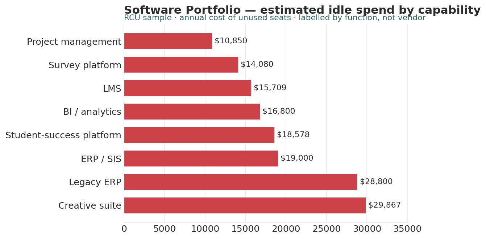

# Software Portfolio Analyst

*Higher Ed AI Cookbook · Recipe · Free to use*

A reusable AI recipe that turns a license inventory into a portfolio read: which tools are healthy, which sit idle, where you own the same capability twice, and which renewals to negotiate first — with every recommendation labelled by how much you should trust it.

## What this recipe does

You give an AI assistant your software/license inventory and the agent instructions in this recipe. It returns a workbook a CIO or budget owner can act on:

- Utilization Scorecard — every application with seats owned/active, utilization, cost, cost-per-active-seat, and a traffic-light status.

- Redundancy & Renewal — category overlap, vendor concentration, and a renewal calendar to negotiate before auto-renew.

- Cost & Waste — total spend and estimated idle spend from unused seats.

- Recommendations — prioritized actions, each tagged research-backed, industry-practice, or analyst-judgment.

- Sources & Methodology — every rule, threshold, and limit written down.

## Who it’s for

CIOs, IT finance/procurement, and operations staff at small institutions managing a few dozen applications without a dedicated SAM function.

## What’s in the recipe

- README (this file) — orients a human, configures the agent, onboards a contractor.

- Agent Instructions — the prompt you paste into the AI tool.

- Sample Output — a fully worked example on a fictional institution, so you see the finished shape.

- Input Template — the expected columns, accepted header aliases, and an example row.

## How to run it

1.  Export your license inventory (one row per application) with seats owned, seats active, annual cost, and renewal date.

2.  Shape it using the Input Template. Fill what you have; blanks are flagged, not guessed.

3.  Open your AI assistant, paste the Agent Instructions, and attach your filled template.

4.  Review the workbook against the Sample Output. Sanity-check the numbers before circulating.

5.  Decide — the recipe is scaffolding for a procurement decision, not the decision.

## Configuration — the knobs that make it yours

Defaults are set for a small institution. Override in the Input Template’s Config tab if your scale differs:

- Healthy utilization: ≥ 80%

- Underused band: 50–80%

- Wasted: \< 50%

- Renewal horizon: flag renewals within 120 days

- Scope: which license types to exclude (e.g. free tiers)

## What it deliberately does NOT do

- It doesn’t cancel contracts, reassign licenses, or negotiate — those are procurement decisions.

- It doesn’t judge value. A low-utilization tool may still be essential; the recipe flags, you weigh.

- It doesn’t read usage telemetry or user identities. Seat-count and cost fields only.

- It doesn’t rename your data silently. Unrecognized columns are flagged for you.

## /help

If you are holding this recipe with no author in the room, here is the orientation:

- help — what this is: a license-portfolio recipe that reads an inventory and returns a utilization/renewal assessment workbook.

- help inputs — what it needs: an inventory with seats owned/active, annual cost, and renewal date (the Input Template shows the shape).

- help outputs — what it gives: a five-tab workbook; the human-legible source of truth is that workbook, not any hidden state.

- help trust — how far to lean on it: recommendations are labelled \[R\]/\[I\]/\[J\]; the Sources & Methodology tab shows every rule. It assembles and flags — it does not decide procurement.

Built by Renee Handy · Higher Ed AI Cookbook · build 2026-07. The human-legible source of truth is the returned workbook, not any hidden state. Before you trust this agent with a real decision, find a competent human — a CIO or procurement lead — and have them check the read against your institution’s reality. An orphaned agent should point you at a person, not at itself.

*License: CC BY-NC-SA 4.0. Free to use and adapt for noncommercial purposes, including at your own institution. Commercial / white-label rights: contact the Cookbook. Sample data is fictional.*

## Sample output

---

## Files in this recipe

- [`SWP_Agent_Instructions.docx`](SWP_Agent_Instructions.docx)
- [`SWP_Input_Template.xlsx`](SWP_Input_Template.xlsx)
- [`SWP_README.docx`](SWP_README.docx)
- [`SWP_Sample_Output.xlsx`](SWP_Sample_Output.xlsx)

- [`fig_03_software_portfolio.png`](fig_03_software_portfolio.png)

*This page is generated from the README `.docx`, which remains the source of truth.*
