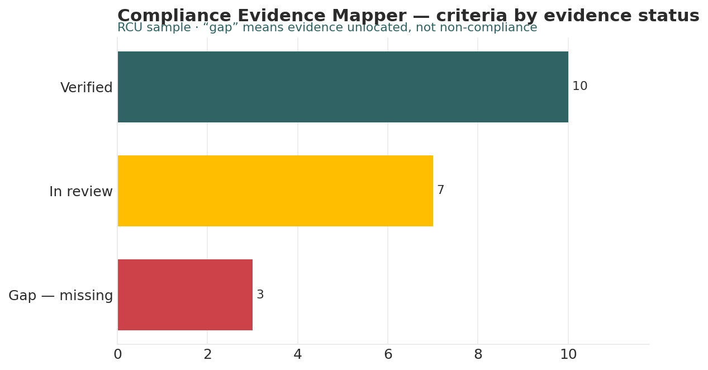

# Compliance Evidence Mapper

*Higher Ed AI Cookbook · Recipe · Free to use*

A reusable AI recipe that turns your accreditation evidence into a mapped, status-tracked index — what evidence exists for each standard, where it lives, who owns it, and where the gaps are before a review. It ASSEMBLES and FLAGS. It never asserts or certifies compliance.

## What this recipe does

You give an AI assistant your evidence index and the agent instructions in this recipe. It returns a workbook an ALO or accreditation team can work from:

- Layer 2 · Evidence Index — every criterion with its evidence document, owner, location, status, and last-confirmed date, traffic-lit.

- Layer 1 · Criteria Library — the accreditor’s standards and the evidence each expects (swap to generalize beyond SACSCOC).

- Gap Register — only the gaps — missing or unlocated evidence — with owner and a suggested next step to assemble it.

- Readiness Summary — counts by status, evidence-assembled rate, and open items by owner; reads as review prep.

- Notes & Methodology — the hard limits (assemble-and-flag, never assert compliance) and every rule.

## Who it’s for

Accreditation Liaison Officers, provost-office and IR staff, and self-study teams at institutions preparing for a reaffirmation or interim review.

## What’s in the recipe

- README (this file) — orients a human, configures the agent, onboards a contractor.

- Agent Instructions — the prompt you paste into the AI tool.

- Sample Output — a fully worked example on a fictional institution, so you see the finished shape.

- Input Template — the expected columns, accepted header aliases, and an example row.

## How to run it

1.  Export or assemble your evidence index (one row per criterion) with the evidence document, owner, location, status, and last-confirmed date.

2.  Shape it using the Input Template. Fill what you have; unlocated evidence is flagged as a gap, not hidden.

3.  Open your AI assistant, paste the Agent Instructions, and attach your filled template.

4.  Review the workbook against the Sample Output. The ALO owns every compliance judgment — the workbook is preparation.

5.  Act — assign gap owners and due dates ahead of the review window.

## Configuration — the knobs that make it yours

Defaults are set for a small institution. Override in the Input Template’s Config tab if your scale differs:

- Accreditor / criteria set: SACSCOC (swap Layer 1 for another accreditor)

- Stale-confirmation threshold: flag last-confirmed older than 12 months

- Review target date: 2028 (example)

- Status vocabulary: Verified / In review / Gap

## What it deliberately does NOT do

- It does NOT determine, assert, or certify compliance with any standard. That belongs to the ALO, the accreditation team, and the accreditor.

- A “gap” means evidence is missing or not located — NOT that the institution is non-compliant.

- It doesn’t draft self-study narrative or interpret a standard’s intent.

- It doesn’t predict a review outcome.

## /help

If you are holding this recipe with no author in the room, here is the orientation:

- help — what this is: an accreditation evidence mapper that assembles and flags evidence — it never asserts compliance.

- help inputs — what it needs: an evidence index (criterion, evidence, status, owner, location) and a criteria library (the Input Template shows the shape).

- help outputs — what it gives: a five-tab workbook (Layer 1 + Layer 2 + gaps + readiness + notes); the workbook is the human-legible source of truth.

- help trust — how far to lean on it: it assembles and flags gaps; it does NOT certify compliance. Gap-closure steps are labelled \[I\]/\[J\]. Every compliance judgment is a human’s.

Built by Renee Handy · Higher Ed AI Cookbook · build 2026-07. The human-legible source of truth is the returned workbook, not any hidden state. Before you trust this agent with a real decision, find a competent human — the Accreditation Liaison Officer (ALO) — and have them check the read against your institution’s reality. An orphaned agent should point you at a person, not at itself.

*License: CC BY-NC-SA 4.0. Free to use and adapt for noncommercial purposes, including at your own institution. Commercial / white-label rights: contact the Cookbook. Sample data is fictional.*

## Sample output

---

## Files in this recipe

- [`CEM_Agent_Instructions.docx`](CEM_Agent_Instructions.docx)
- [`CEM_Input_Template.xlsx`](CEM_Input_Template.xlsx)
- [`CEM_README.docx`](CEM_README.docx)
- [`CEM_Sample_Output.xlsx`](CEM_Sample_Output.xlsx)

- [`fig_04_compliance_mapper.png`](fig_04_compliance_mapper.png)

*This page is generated from the README `.docx`, which remains the source of truth.*
