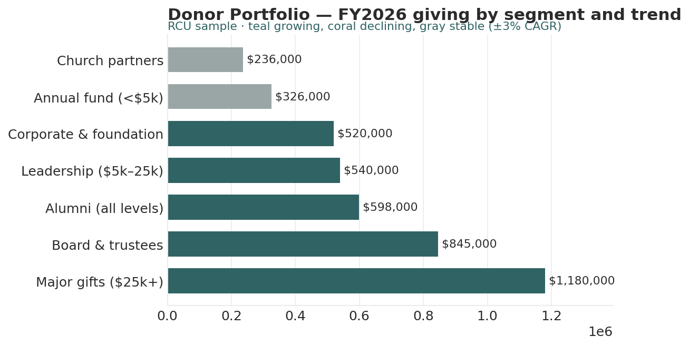

# Donor Portfolio Analyst

*Higher Ed AI Cookbook · Recipe · Free to use*

A reusable AI recipe that reads giving by donor segment as a portfolio — which segments anchor the fund, which are growing, where concentration risk sits, and where lapsed donors can be recovered — with every recommendation labelled by how much you should trust it.

## What this recipe does

You give an AI assistant your giving summary and the agent instructions in this recipe. It returns a workbook an advancement leader can act on:

- Giving Scorecard — each segment’s latest giving, 5-yr CAGR, trend, share of total, and LYBUNT/SYBUNT.

- Trend Analysis — five-year giving by segment with CAGR and net change.

- Concentration & Risk — segment concentration flags and lapsed-donor risk.

- Recommendations — prioritized actions, each tagged research-backed, industry-practice, or analyst-judgment.

- Sources & Methodology — every rule, threshold, and limit written down.

## Who it’s for

VPs of advancement, annual-giving directors, and advancement-services staff at small shops without a dedicated prospect-analytics function.

## What’s in the recipe

- README (this file) — orients a human, configures the agent, onboards a contractor.

- Agent Instructions — the prompt you paste into the AI tool.

- Sample Output — a fully worked example on a fictional institution, so you see the finished shape.

- Input Template — the expected columns, accepted header aliases, and an example row.

## How to run it

1.  Export giving totals by donor segment and fiscal year, with LYBUNT/SYBUNT counts.

2.  Shape it using the Input Template. Fill what you have; a missing year is flagged, not interpolated.

3.  Open your AI assistant, paste the Agent Instructions, and attach your filled template.

4.  Review the workbook against the Sample Output. Sanity-check totals before circulating.

5.  Decide — the recipe is scaffolding for an advancement-strategy decision, not the decision.

## Configuration — the knobs that make it yours

Defaults are set for a small institution. Override in the Input Template’s Config tab if your scale differs:

- Concentration flag: segment ≥ 15% of total giving

- Trend band: ±3% five-year CAGR

- Segments: edit to your segmentation

- Scope: exclude one-time bequests if desired

## What it deliberately does NOT do

- It doesn’t assign prospects, set ask amounts, or run moves management — those are gift-officer decisions.

- It works at segment/portfolio level. It does NOT score, rank, or target individual donors beyond illustrative context.

- It doesn’t read wealth-screening or individual PII.

- It doesn’t rename your data silently. Unrecognized columns are flagged.

## /help

If you are holding this recipe with no author in the room, here is the orientation:

- help — what this is: a giving-portfolio recipe that reads a segment giving summary and returns an advancement assessment workbook.

- help inputs — what it needs: giving by donor segment and fiscal year with LYBUNT/SYBUNT (the Input Template shows the shape).

- help outputs — what it gives: a five-tab workbook; the human-legible source of truth is that workbook, not any hidden state.

- help trust — how far to lean on it: recommendations are labelled \[R\]/\[I\]/\[J\]; the Sources & Methodology tab shows every rule. Segment level — never individual targeting.

Built by Renee Handy · Higher Ed AI Cookbook · build 2026-07. The human-legible source of truth is the returned workbook, not any hidden state. Before you trust this agent with a real decision, find a competent human — a VP of advancement — and have them check the read against your institution’s reality. An orphaned agent should point you at a person, not at itself.

*License: CC BY-NC-SA 4.0. Free to use and adapt for noncommercial purposes, including at your own institution. Commercial / white-label rights: contact the Cookbook. Sample data is fictional.*

## Sample output

---

## Files in this recipe

- [`DPA_Agent_Instructions.docx`](DPA_Agent_Instructions.docx)
- [`DPA_Input_Template.xlsx`](DPA_Input_Template.xlsx)
- [`DPA_README.docx`](DPA_README.docx)
- [`DPA_Sample_Output.xlsx`](DPA_Sample_Output.xlsx)

- [`fig_06_donor_portfolio.png`](fig_06_donor_portfolio.png)

*This page is generated from the README `.docx`, which remains the source of truth.*
