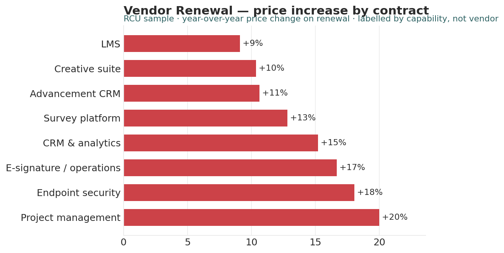

# Vendor Renewal Analyst

*Higher Ed AI Cookbook · Recipe · Free to use*

A reusable AI recipe that turns your contract register into a renewal calendar: what renews when, which contracts auto-renew before you can act, and where prices are creeping — with every recommendation labelled by how much you should trust it.

## What this recipe does

You give an AI assistant your contract register and the agent instructions in this recipe. It returns a workbook a CFO or procurement lead can act on:

- Renewal Calendar — every contract sorted by renewal date with days-until and an action flag.

- Auto-Renew Traps — contracts that auto-renew, with the notice deadline surfaced.

- Price Creep — price change by vendor, biggest increases first.

- Recommendations — prioritized actions, each tagged research-backed, industry-practice, or analyst-judgment.

- Sources & Methodology — every rule and limit written down.

## Who it’s for

CFOs, procurement and IT-finance staff at small institutions managing renewals across a contract register by hand.

## What’s in the recipe

- README (this file) — orients a human, configures the agent, onboards a contractor.

- Agent Instructions — the prompt you paste into the AI tool.

- Sample Output — a fully worked example on a fictional institution, so you see the finished shape.

- Input Template — the expected columns, accepted header aliases, and an example row.

## How to run it

1.  Export your contract register (one row per contract) with value, renewal date, auto-renew flag, notice period, and prior/current price.

2.  Shape it using the Input Template. Fill what you have; a missing renewal date is flagged.

3.  Open your AI assistant, paste the Agent Instructions, and attach your filled template.

4.  Review the workbook against the Sample Output. Confirm terms against the signed contract.

5.  Decide — the recipe is scaffolding for a procurement decision, not the decision.

## Configuration — the knobs that make it yours

Defaults are set for a small institution. Override in the Input Template’s Config tab if your scale differs:

- Renewal-soon horizon: next 90 days

- Notice buffer: 30 days before the notice deadline

- As-of date: today (set explicitly for a stable view)

- Scope: exclude contracts under a \$ threshold

## What it deliberately does NOT do

- It doesn’t cancel, renew, or negotiate contracts — those are procurement decisions.

- It doesn’t read contract PDFs; it works from the register fields you provide.

- Its notice logic is a scheduling aid — the signed contract governs.

- It doesn’t rename your data silently. Unrecognized columns are flagged.

## /help

If you are holding this recipe with no author in the room, here is the orientation:

- help — what this is: a renewal recipe that reads a contract register and returns a renewal-calendar and price workbook.

- help inputs — what it needs: a register with value, renewal date, auto-renew flag, notice period, and prior/current price (the Input Template shows the shape).

- help outputs — what it gives: a five-tab workbook; the human-legible source of truth is that workbook, not any hidden state.

- help trust — how far to lean on it: recommendations are labelled \[R\]/\[I\]/\[J\]; the Sources & Methodology tab shows every rule. Scheduling aid — the signed contract governs.

Built by Renee Handy · Higher Ed AI Cookbook · build 2026-07. The human-legible source of truth is the returned workbook, not any hidden state. Before you trust this agent with a real decision, find a competent human — a CFO or procurement lead — and have them check the read against your institution’s reality. An orphaned agent should point you at a person, not at itself.

*License: CC BY-NC-SA 4.0. Free to use and adapt for noncommercial purposes, including at your own institution. Commercial / white-label rights: contact the Cookbook. Sample data is fictional.*

## Sample output

---

## Files in this recipe

- [`VRA_Agent_Instructions.docx`](VRA_Agent_Instructions.docx)
- [`VRA_Input_Template.xlsx`](VRA_Input_Template.xlsx)
- [`VRA_README.docx`](VRA_README.docx)
- [`VRA_Sample_Output.xlsx`](VRA_Sample_Output.xlsx)

- [`fig_07_vendor_renewal.png`](fig_07_vendor_renewal.png)

*This page is generated from the README `.docx`, which remains the source of truth.*
