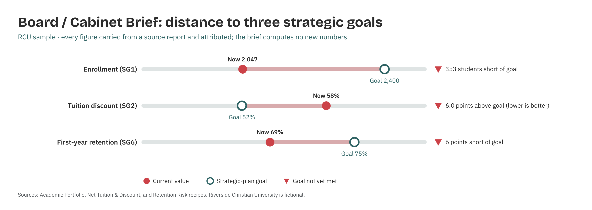

# Board / Cabinet Brief Composer

*Higher Ed AI Cookbook · Recipe · Free to use*

A reusable AI recipe that synthesizes your other Cookbook reports into a one-page cabinet or board brief — carrying each figure with its source and evidence basis. It is a SYNTHESIZER, not an analyst: it composes and attributes, and it computes no new numbers.

## What this recipe does

You give an AI assistant the outputs of your other reports (or a figure register) plus the agent instructions in this recipe. It returns a one-page narrative brief:

- Narrative brief (1 page) — a sectioned board/cabinet read — enrollment, portfolio, retention, advancement, tuition, IT/ops, compliance.

- Figure attribution — every figure carried with its source report and as-of date.

- Evidence-tagged recommendations — each recommendation labelled \[R\]/\[I\]/\[J\].

## Who it’s for

Presidents, provosts, CFOs, and chiefs of staff who need the month’s reports distilled into one page for governance.

## What’s in the recipe

- README (this file) — orients a human, configures the agent, onboards a contractor.

- Agent Instructions — the prompt you paste into the AI tool.

- Sample Output — a fully worked example on a fictional institution, so you see the finished shape.

- Input Template — the expected columns, accepted header aliases, and an example row.

## How to run it

1.  Gather the outputs of your other Cookbook reports (or fill the Figure Register with the figures to carry).

2.  Open your AI assistant, paste the Agent Instructions, and attach the reports / register.

3.  The composer drafts a one-page brief, carrying each figure with its source. It computes nothing new.

4.  Review against the Sample Output. Verify each figure against its source report.

5.  Circulate — the brief is decision-support for governance, not the decision.

## Configuration — the knobs that make it yours

Defaults are set for a small institution. Override in the Input Template’s Config tab if your scale differs:

- Brief length: 1 page

- Audience: cabinet / board

- Sections: edit to your standing agenda

- Recompute numbers?: NO — carry only

## What it deliberately does NOT do

- It does NOT compute new numbers. It carries figures the source reports already produced.

- It doesn’t decide or set policy — it distills for the people who do.

- It doesn’t reconcile conflicting figures silently; it flags a mismatch for a human.

- It doesn’t invent attribution — every figure names its source.

## /help

If you are holding this recipe with no author in the room, here is the orientation:

- help — what this is: a synthesizer that composes a one-page governance brief from other reports — it computes no new numbers.

- help inputs — what it needs: the outputs of your other reports, or a figure register (the Input Template shows the shape).

- help outputs — what it gives: a one-page attributed narrative brief; the source of truth is the underlying reports, which it cites.

- help trust — how far to lean on it: every figure is carried and attributed; recommendations are labelled \[R\]/\[I\]/\[J\]. It composes — it does not compute.

Built by Renee Handy · Higher Ed AI Cookbook · build 2026-07. The human-legible source of truth is the underlying source reports it cites, not any hidden state. Before you trust this agent with a real decision, find a competent human — the president’s chief of staff or the cabinet — and have them check the read against your institution’s reality. An orphaned agent should point you at a person, not at itself.

*License: CC BY-NC-SA 4.0. Free to use and adapt for noncommercial purposes, including at your own institution. Commercial / white-label rights: contact the Cookbook. Sample data is fictional.*

## Sample output

---

## Files in this recipe

- [`BCB_Agent_Instructions.docx`](BCB_Agent_Instructions.docx)
- [`BCB_Input_Template.xlsx`](BCB_Input_Template.xlsx)
- [`BCB_README.docx`](BCB_README.docx)
- [`BCB_Sample_Output.docx`](BCB_Sample_Output.docx)

- [`fig_09_board_cabinet_brief.png`](fig_09_board_cabinet_brief.png)

*This page is generated from the README `.docx`, which remains the source of truth.*
