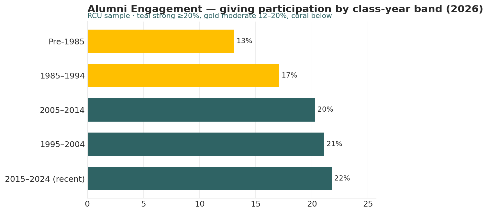

# Alumni Engagement Analyst

*Higher Ed AI Cookbook · Recipe · Free to use*

A reusable AI recipe that reads alumni engagement as a portfolio over time — events, email, volunteering, and giving participation by class-year band — so you can see which cohorts are engaged and where the giving pipeline leaks, with every recommendation labelled by how much you should trust it.

## What this recipe does

You give an AI assistant your engagement export and the agent instructions in this recipe. It returns a workbook an alumni-relations leader can act on:

- Engagement Scorecard — each class-year band’s events, email, volunteers, and giving participation with a status.

- Engagement Trend — engagement and giving participation by year.

- Recommendations — prioritized actions, each tagged research-backed, industry-practice, or analyst-judgment.

- Sources & Methodology — every rule and limit written down.

## Who it’s for

Alumni-relations and annual-giving staff at small institutions tracking engagement across cohorts by hand.

## What’s in the recipe

- README (this file) — orients a human, configures the agent, onboards a contractor.

- Agent Instructions — the prompt you paste into the AI tool.

- Sample Output — a fully worked example on a fictional institution, so you see the finished shape.

- Input Template — the expected columns, accepted header aliases, and an example row.

## How to run it

1.  Export engagement by class-year band and year (events, email open/click, volunteers, board, giving participation).

2.  Shape it using the Input Template. Fill what you have; a missing metric is flagged.

3.  Open your AI assistant, paste the Agent Instructions, and attach your filled template.

4.  Review the workbook against the Sample Output. Sanity-check before circulating.

5.  Decide — the recipe is scaffolding for an engagement-strategy decision, not the decision.

## Configuration — the knobs that make it yours

Defaults are set for a small institution. Override in the Input Template’s Config tab if your scale differs:

- Strong participation: ≥ 20%

- Moderate band: 12–20%

- Bands: edit to your cohort definitions

- Scope: exclude lost/deceased records

## What it deliberately does NOT do

- It doesn’t run campaigns or target individuals — those are staff decisions.

- It works at band/segment level. It does NOT profile individual alumni.

- It doesn’t read individual contact records or PII.

- It doesn’t rename your data silently. Unrecognized columns are flagged.

## /help

If you are holding this recipe with no author in the room, here is the orientation:

- help — what this is: an engagement-portfolio recipe that reads a cohort engagement export and returns an assessment workbook.

- help inputs — what it needs: engagement by class-year band and year (the Input Template shows the shape).

- help outputs — what it gives: a four-tab workbook; the human-legible source of truth is that workbook, not any hidden state.

- help trust — how far to lean on it: recommendations are labelled \[R\]/\[I\]/\[J\]; the Sources & Methodology tab shows every rule. Segment level — no individual profiling.

Built by Renee Handy · Higher Ed AI Cookbook · build 2026-07. The human-legible source of truth is the returned workbook, not any hidden state. Before you trust this agent with a real decision, find a competent human — an alumni-relations director — and have them check the read against your institution’s reality. An orphaned agent should point you at a person, not at itself.

*License: free to use and adapt for your own institution. White-label / resale rights reserved — contact the Cookbook. Sample data is fictional.*

## Sample output

---

## Files in this recipe

- [`ALE_Agent_Instructions.docx`](ALE_Agent_Instructions.docx)
- [`ALE_Input_Template.xlsx`](ALE_Input_Template.xlsx)
- [`ALE_README.docx`](ALE_README.docx)
- [`ALE_Sample_Output.xlsx`](ALE_Sample_Output.xlsx)

- [`fig_10_alumni_engagement.png`](fig_10_alumni_engagement.png)

*This page is generated from the README `.docx`, which remains the source of truth.*
