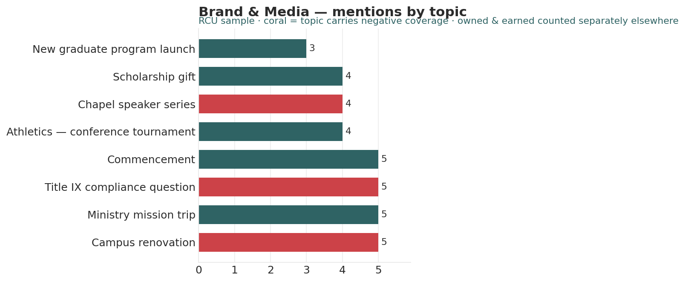

# Brand / Media Analyst

*Higher Ed AI Cookbook · Recipe · Free to use*

A reusable AI recipe that turns a media clip log into an owned-vs-earned coverage read — volume, sentiment, and the topics driving coverage — for a small shop without an enterprise media-measurement service. Reach is treated as a directional estimate, never an audited audience.

## What this recipe does

You give an AI assistant your clip log and the agent instructions in this recipe. It returns a workbook a communications lead can act on:

- Coverage Scorecard — owned vs earned mention counts and estimated reach, reported separately, with sentiment mix.

- Topics & Sentiment — the topics driving coverage and where negative coverage concentrates.

- Recommendations — prioritized actions, each tagged research-backed, industry-practice, or analyst-judgment.

- Notes & Methodology — the hard limits (no reach overstatement) and every rule.

## Who it’s for

Communications and marketing staff at small institutions tracking coverage in a spreadsheet, not an enterprise tool.

## What’s in the recipe

- README (this file) — orients a human, configures the agent, onboards a contractor.

- Agent Instructions — the prompt you paste into the AI tool.

- Sample Output — a fully worked example on a fictional institution, so you see the finished shape.

- Input Template — the expected columns, accepted header aliases, and an example row.

## How to run it

1.  Export your clip log (one row per mention) with outlet, type (owned/earned), topic, sentiment, and estimated reach.

2.  Shape it using the Input Template. A mention missing a type or reach is flagged, not assumed.

3.  Open your AI assistant, paste the Agent Instructions, and attach your filled template.

4.  Review the workbook against the Sample Output. Treat reach as directional.

5.  Decide — the recipe is scaffolding for a communications decision, not the decision.

## Configuration — the knobs that make it yours

Defaults are set for a small institution. Override in the Input Template’s Config tab if your scale differs:

- Owned/earned tags: Owned / Earned (edit to your taxonomy)

- Sentiment scale: Positive / Neutral / Negative

- Reach handling: directional estimate — report as ranges

- Scope: exclude paid/advertising placements

## What it deliberately does NOT do

- It does NOT report a summed “audience reached.” Reach is an unaudited estimate, reported directionally.

- It does NOT merge owned and earned into one credibility or audience figure — they are different.

- It doesn’t place stories or approve statements — those are staff decisions.

- It doesn’t treat sentiment as a measured metric; it’s a directional human tag.

## /help

If you are holding this recipe with no author in the room, here is the orientation:

- help — what this is: a small-shop media recipe that reads a clip log and returns an owned-vs-earned coverage workbook.

- help inputs — what it needs: a clip log with outlet, type, topic, sentiment, and estimated reach (the Input Template shows the shape).

- help outputs — what it gives: a four-tab workbook; the human-legible source of truth is that workbook, not any hidden state.

- help trust — how far to lean on it: recommendations are labelled \[R\]/\[I\]/\[J\]; reach is directional, owned and earned are kept separate. It assembles and flags — it does not measure.

Built by Renee Handy · Higher Ed AI Cookbook · build 2026-07. The human-legible source of truth is the returned workbook, not any hidden state. Before you trust this agent with a real decision, find a competent human — a communications director — and have them check the read against your institution’s reality. An orphaned agent should point you at a person, not at itself.

*License: CC BY-NC-SA 4.0. Free to use and adapt for noncommercial purposes, including at your own institution. Commercial / white-label rights: contact the Cookbook. Sample data is fictional.*

## Sample output

---

## Files in this recipe

- [`BMA_Agent_Instructions.docx`](BMA_Agent_Instructions.docx)
- [`BMA_Input_Template.xlsx`](BMA_Input_Template.xlsx)
- [`BMA_README.docx`](BMA_README.docx)
- [`BMA_Sample_Output.xlsx`](BMA_Sample_Output.xlsx)

- [`fig_12_brand_media.png`](fig_12_brand_media.png)

*This page is generated from the README `.docx`, which remains the source of truth.*
