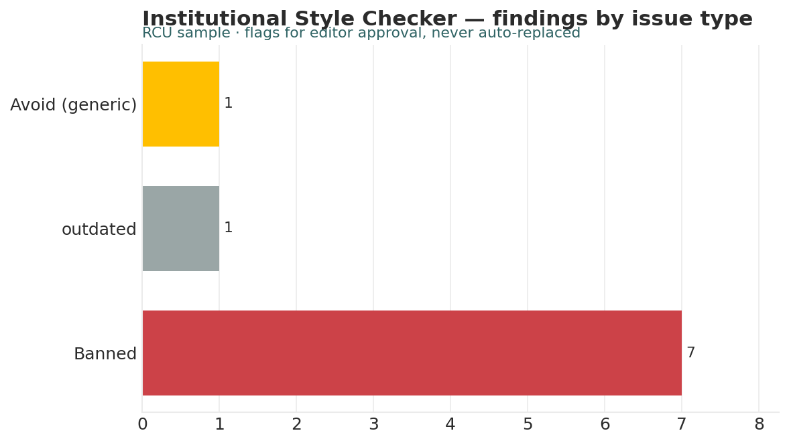

# Institutional Style Checker

*Higher Ed AI Cookbook · Recipe · Free to use*

A reusable AI recipe that checks copy against your institutional style dictionary — preferred, accepted-variant, and banned terms — and flags issues with the preferred fix, so writing stays on-brand and on-mission. It flags; a human approves each change.

## What this recipe does

You give an AI assistant your style dictionary and a draft, plus the agent instructions in this recipe. It returns a workbook an editor can act on:

- Check Findings — each flagged term with the issue, the preferred form, and the rationale.

- Style Dictionary — the preferred / variant / banned term table.

- Before & After — the draft as submitted and a suggested corrected version.

- Notes & Methodology — the rules and limits (flag, don’t auto-replace).

## Who it’s for

Communications, marketing, and web editors keeping copy consistent with institutional style and mission language.

## What’s in the recipe

- README (this file) — orients a human, configures the agent, onboards a contractor.

- Agent Instructions — the prompt you paste into the AI tool.

- Sample Output — a fully worked example on a fictional institution, so you see the finished shape.

- Input Template — the expected columns, accepted header aliases, and an example row.

## How to run it

1.  Provide your style dictionary (preferred / accepted variant / banned, with rationale) and the draft to check.

2.  Shape the dictionary using the Input Template. Unknown terms are left untouched and noted.

3.  Open your AI assistant, paste the Agent Instructions, and attach the dictionary and draft.

4.  Review the findings and the before/after. Approve each change in context.

5.  Publish — the recipe assists editing; the editor decides.

## Configuration — the knobs that make it yours

Defaults are set for a small institution. Override in the Input Template’s Config tab if your scale differs:

- Tiers: Preferred / Accepted variant / Banned

- Match: case-insensitive whole-word

- Scope: sections to skip, e.g. quoted material

- Mission terms: flag generic substitutes for mission language

## What it deliberately does NOT do

- It doesn’t auto-replace text — every change is a suggestion a human approves.

- It doesn’t overrule an editor’s contextual judgment.

- It doesn’t invent rules; it applies your dictionary.

- It leaves unknown terms untouched and notes them.

## /help

If you are holding this recipe with no author in the room, here is the orientation:

- help — what this is: a style recipe that checks copy against your dictionary and flags issues with the preferred fix.

- help inputs — what it needs: a style dictionary and a draft (the Input Template shows the dictionary shape).

- help outputs — what it gives: a four-tab workbook; the human-legible source of truth is that workbook, not any hidden state.

- help trust — how far to lean on it: suggestions are flagged for editor approval; most style calls are \[J\] house-style judgment. It flags — it does not publish.

Built by Renee Handy · Higher Ed AI Cookbook · build 2026-07. The human-legible source of truth is the returned workbook and your dictionary, not any hidden state. Before you trust this agent with a real decision, find a competent human — a communications editor — and have them check the read against your institution’s reality. An orphaned agent should point you at a person, not at itself.

*License: free to use and adapt for your own institution. White-label / resale rights reserved — contact the Cookbook. Sample data is fictional.*

## Sample output

---

## Files in this recipe

- [`IDS_Agent_Instructions.docx`](IDS_Agent_Instructions.docx)
- [`IDS_Input_Template.xlsx`](IDS_Input_Template.xlsx)
- [`IDS_README.docx`](IDS_README.docx)
- [`IDS_Sample_Output.xlsx`](IDS_Sample_Output.xlsx)

- [`fig_13_style_checker.png`](fig_13_style_checker.png)

*This page is generated from the README `.docx`, which remains the source of truth.*
