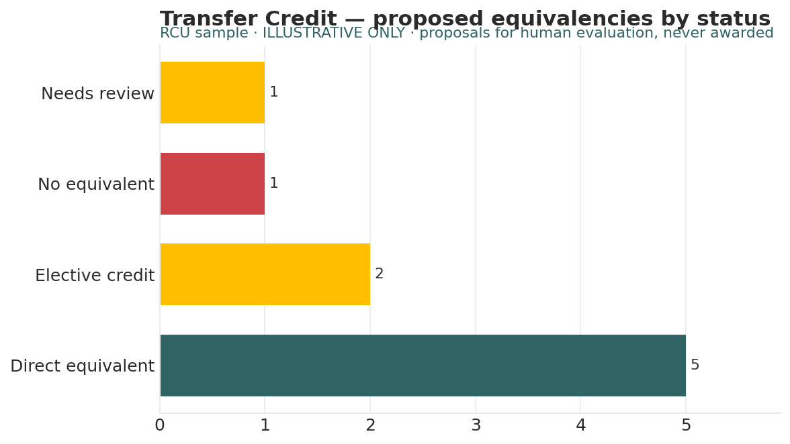

# Transfer Credit Evaluator

*Higher Ed AI Cookbook · Recipe · Free to use*

A reusable AI recipe that drafts transfer-credit equivalencies — sending course → your equivalent — for human evaluation. ⚠ This is the Cookbook’s weakest link: it looks clean but is only as good as your real articulation data. The sample is ILLUSTRATIVE and must not be used to award credit.

## What this recipe does

You give an AI assistant your articulation data and incoming courses, plus the agent instructions in this recipe. It returns a worksheet a registrar can evaluate:

- Evaluation Worksheet — each sending course with a proposed equivalent, match basis, and status.

- Summary — counts by status.

- Notes & Methodology — the hard limits — illustrative only, needs real articulation data to deploy.

## Who it’s for

Registrars, transfer-credit evaluators, and academic advisors — only once real articulation data is in hand.

## What’s in the recipe

- README (this file) — orients a human, configures the agent, onboards a contractor.

- Agent Instructions — the prompt you paste into the AI tool.

- Sample Output — a fully worked example on a fictional institution, so you see the finished shape.

- Input Template — the expected columns, accepted header aliases, and an example row.

## How to run it

1.  Provide your articulation agreements and course-equivalency data, plus the incoming courses to evaluate.

2.  Shape it using the Input Template. Without a real equivalency record, a course is marked “Needs review.”

3.  Open your AI assistant, paste the Agent Instructions, and attach your data.

4.  The registrar and faculty evaluate every proposed equivalent. The recipe does not award credit.

5.  Record decisions in your SIS — the human, not the recipe, makes the award.

## Configuration — the knobs that make it yours

Defaults are set for a small institution. Override in the Input Template’s Config tab if your scale differs:

- Status set: Direct equivalent / Elective credit / Needs review / No equivalent

- Default when no record: Needs review

- Scope: which subjects require faculty sign-off

## What it deliberately does NOT do

- It does NOT award transfer credit. Every proposed equivalent is a suggestion for human evaluation.

- It is NOT deployable without your real articulation agreements and course-equivalency data.

- It does not guess an equivalent when no record exists — it marks “Needs review.”

- It does not overrule faculty or registrar judgment.

## /help

If you are holding this recipe with no author in the room, here is the orientation:

- help — what this is: a transfer-credit recipe that DRAFTS equivalencies for human evaluation — it never awards credit, and is illustrative without real data.

- help inputs — what it needs: articulation/equivalency data and incoming courses (the Input Template shows the shape).

- help outputs — what it gives: a three-tab worksheet; the human-legible source of truth is that worksheet, not any hidden state.

- help trust — how far to lean on it: proposals are for human evaluation only; most are \[J\] until real articulation data confirms. It proposes — the registrar awards.

Built by Renee Handy · Higher Ed AI Cookbook · build 2026-07. The human-legible source of truth is the returned worksheet and your articulation data, not any hidden state. Before you trust this agent with a real decision, find a competent human — the registrar or a faculty evaluator — and have them check the read against your institution’s reality. An orphaned agent should point you at a person, not at itself.

*License: free to use and adapt for your own institution. White-label / resale rights reserved — contact the Cookbook. Sample data is fictional.*

## Sample output

---

## Files in this recipe

- [`TCE_Agent_Instructions.docx`](TCE_Agent_Instructions.docx)
- [`TCE_Input_Template.xlsx`](TCE_Input_Template.xlsx)
- [`TCE_README.docx`](TCE_README.docx)
- [`TCE_Sample_Output.xlsx`](TCE_Sample_Output.xlsx)

- [`fig_14_transfer_credit.png`](fig_14_transfer_credit.png)

*This page is generated from the README `.docx`, which remains the source of truth.*
