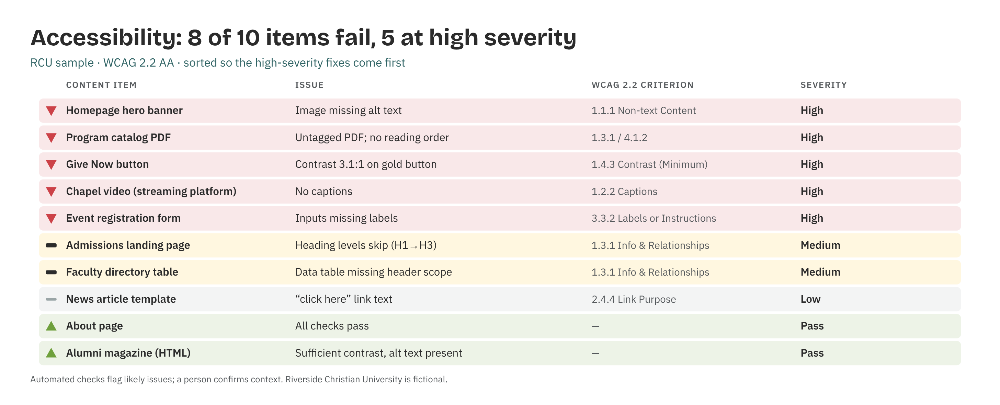

# Accessibility Compliance Checker

*Higher Ed AI Cookbook · Recipe · Free to use*

A reusable AI recipe that reviews a content inventory against WCAG 2.2 AA — flagging likely failures by criterion and severity, with the high-impact fixes first — so a small web/comms team can prioritize remediation. It flags; humans remediate and verify.

## What this recipe does

You give an AI assistant your content inventory and the agent instructions in this recipe. It returns a workbook a web team can act on:

- WCAG Findings — each item with the issue, the WCAG success criterion, severity, and pass/fail status.

- Summary — pass/fail counts and high-severity failures to fix first.

- Recommendations — prioritized remediation, each tagged research-backed, industry-practice, or analyst-judgment.

- Notes & Methodology — the standard, rules, and limits.

## Who it’s for

Web, communications, and IT staff at small institutions responsible for accessible content without a dedicated accessibility team.

## What’s in the recipe

- README (this file) — orients a human, configures the agent, onboards a contractor.

- Agent Instructions — the prompt you paste into the AI tool.

- Sample Output — a fully worked example on a fictional institution, so you see the finished shape.

- Input Template — the expected columns, accepted header aliases, and an example row.

## How to run it

1.  Assemble a content inventory (pages, PDFs, videos, forms) to review.

2.  Shape it using the Input Template. Automated flags are paired with a human context check.

3.  Open your AI assistant, paste the Agent Instructions, and attach your inventory.

4.  Review findings; fix high-severity items first. Confirm context (decorative vs. meaningful).

5.  Remediate — the recipe assists; assistive-technology testing and human judgment finish the job.

## Configuration — the knobs that make it yours

Defaults are set for a small institution. Override in the Input Template’s Config tab if your scale differs:

- Standard: WCAG 2.2 AA

- Severity bands: High / Medium / Low

- Scope: content types to include (pages, PDFs, video, forms)

- Sampling: full inventory or a representative sample

## What it deliberately does NOT do

- It doesn’t remediate content or certify legal compliance.

- It doesn’t replace manual and assistive-technology testing — automated checks miss context.

- It doesn’t judge a decorative image as a failure without human confirmation.

- It doesn’t rename your data silently. Unrecognized columns are flagged.

## /help

If you are holding this recipe with no author in the room, here is the orientation:

- help — what this is: a WCAG 2.2 AA recipe that reviews a content inventory and flags likely failures by criterion and severity.

- help inputs — what it needs: a content inventory of pages, PDFs, videos, and forms (the Input Template shows the shape).

- help outputs — what it gives: a four-tab workbook; the human-legible source of truth is that workbook, not any hidden state.

- help trust — how far to lean on it: recommendations are labelled \[R\]/\[I\]/\[J\]; automated flags need human context confirmation. It flags — it does not certify.

Built by Renee Handy · Higher Ed AI Cookbook · build 2026-07. The human-legible source of truth is the returned workbook, not any hidden state. Before you trust this agent with a real decision, find a competent human — a web/accessibility lead — and have them check the read against your institution’s reality. An orphaned agent should point you at a person, not at itself.

*License: CC BY-NC-SA 4.0. Free to use and adapt for noncommercial purposes, including at your own institution. Commercial / white-label rights: contact the Cookbook. Sample data is fictional.*

## Sample output

---

## Files in this recipe

- [`ACC_Agent_Instructions.docx`](ACC_Agent_Instructions.docx)
- [`ACC_Input_Template.xlsx`](ACC_Input_Template.xlsx)
- [`ACC_README.docx`](ACC_README.docx)
- [`ACC_Sample_Output.xlsx`](ACC_Sample_Output.xlsx)

- [`fig_15_accessibility_checker.png`](fig_15_accessibility_checker.png)

*This page is generated from the README `.docx`, which remains the source of truth.*
