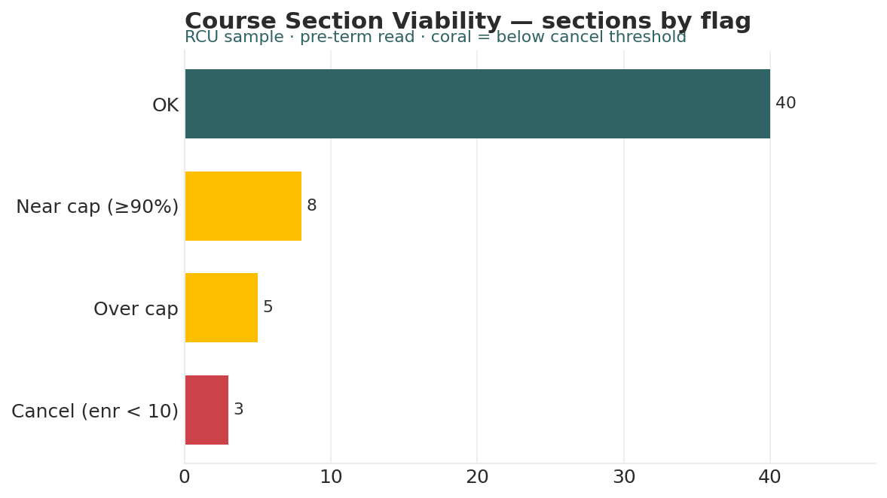

# Course Section Viability Analyzer

*Higher Ed AI Cookbook · Recipe · Free to use*

A reusable AI recipe that turns a term course-schedule export into a pre-term viability read: which sections are under-enrolled, which are over cap, how fill rate varies by school, and where instructor load is heavy — with every recommendation labelled by how much you should trust it.

## What this recipe does

You give an AI assistant your section schedule and the agent instructions in this recipe. It returns a workbook a provost or dean can act on before the term starts:

- Viability Scorecard — every section with fill rate and a flag (under-enrolled / over cap / near cap / OK).

- Fill by School — sections, seats offered and filled, and fill rate by school.

- Instructor Load — sections and seats per instructor, with an overload flag.

- Recommendations — prioritized actions, each tagged research-backed, industry-practice, or analyst-judgment.

- Sources & Methodology — every rule and limit written down.

## Who it’s for

Provosts, deans, and registrars making pre-term cancellation and staffing calls.

## What’s in the recipe

- README (this file) — orients a human, configures the agent, onboards a contractor.

- Agent Instructions — the prompt you paste into the AI tool.

- Sample Output — a fully worked example on a fictional institution, so you see the finished shape.

- Input Template — the expected columns, accepted header aliases, and an example row.

## How to run it

1.  Export your term schedule (one row per section) with school, instructor, seat cap, and enrolled.

2.  Shape it using the Input Template. A section missing cap or enrolled is flagged.

3.  Open your AI assistant, paste the Agent Instructions, and attach your filled template.

4.  Review the workbook against the Sample Output. Confirm against required-course needs.

5.  Decide — the recipe is scaffolding for a scheduling decision, not the decision.

## Configuration — the knobs that make it yours

Defaults are set for a small institution. Override in the Input Template’s Config tab if your scale differs:

- Cancellation threshold: enrolled \< 10

- Near-cap: fill ≥ 90%

- Overload: \> 4 sections per instructor

- Scope: exclude independent studies / labs

## What it deliberately does NOT do

- It doesn’t cancel sections or assign faculty — those are academic decisions.

- Fill rate is one input to viability, not the whole picture (required courses, sequencing).

- It doesn’t read student rosters or individual data.

- It doesn’t rename your data silently. Unrecognized columns are flagged.

## /help

If you are holding this recipe with no author in the room, here is the orientation:

- help — what this is: a section-viability recipe that reads a term schedule and returns a pre-term viability workbook.

- help inputs — what it needs: a schedule export with school, instructor, seat cap, and enrolled (the Input Template shows the shape).

- help outputs — what it gives: a five-tab workbook; the human-legible source of truth is that workbook, not any hidden state.

- help trust — how far to lean on it: recommendations are labelled \[R\]/\[I\]/\[J\]; fill rate is one input among several. It flags — it does not cancel.

Built by Renee Handy · Higher Ed AI Cookbook · build 2026-07. The human-legible source of truth is the returned workbook, not any hidden state. Before you trust this agent with a real decision, find a competent human — a provost or dean — and have them check the read against your institution’s reality. An orphaned agent should point you at a person, not at itself.

*License: CC BY-NC-SA 4.0. Free to use and adapt for noncommercial purposes, including at your own institution. Commercial / white-label rights: contact the Cookbook. Sample data is fictional.*

## Sample output

---

## Files in this recipe

- [`CSV_Agent_Instructions.docx`](CSV_Agent_Instructions.docx)
- [`CSV_Input_Template.xlsx`](CSV_Input_Template.xlsx)
- [`CSV_README.docx`](CSV_README.docx)
- [`CSV_Sample_Output.xlsx`](CSV_Sample_Output.xlsx)

- [`fig_16_course_section_viability.png`](fig_16_course_section_viability.png)

*This page is generated from the README `.docx`, which remains the source of truth.*
