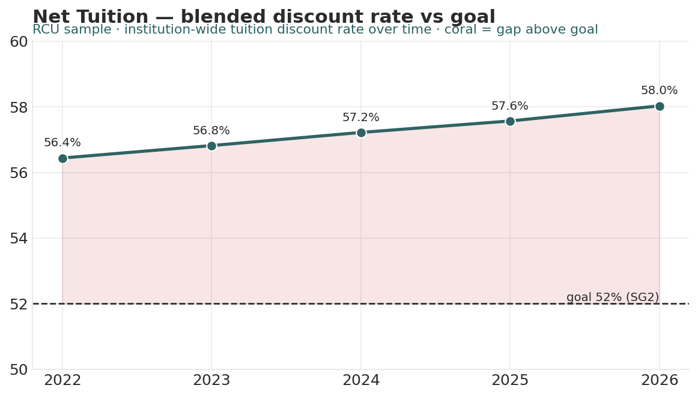

# Net Tuition Revenue & Discount Analyzer

*Higher Ed AI Cookbook · Recipe · Free to use*

A reusable AI recipe that turns an aid/awards summary into the CFO/board view: gross tuition, funded vs unfunded institutional aid, net tuition revenue, and discount rate by segment — trended against your discount-rate goal, with every recommendation labelled by how much you should trust it.

## What this recipe does

You give an AI assistant your aid summary and the agent instructions in this recipe. It returns a workbook finance and the board can act on:

- Net Tuition Scorecard — each segment’s headcount, gross, aid, net tuition, and discount rate for the latest year.

- Discount Trend — institution-wide discount rate over time, with the gap to goal.

- Recommendations — prioritized actions, each tagged research-backed, industry-practice, or analyst-judgment.

- Sources & Methodology — every rule and limit written down.

## Who it’s for

CFOs, budget offices, and boards translating enrollment into net revenue and monitoring the discount rate.

## What’s in the recipe

- README (this file) — orients a human, configures the agent, onboards a contractor.

- Agent Instructions — the prompt you paste into the AI tool.

- Sample Output — a fully worked example on a fictional institution, so you see the finished shape.

- Input Template — the expected columns, accepted header aliases, and an example row.

## How to run it

1.  Export your aid/awards summary by segment and year (headcount, gross tuition, institutional aid).

2.  Shape it using the Input Template. Segment/cohort level — no individual award records.

3.  Open your AI assistant, paste the Agent Instructions, and attach your filled template.

4.  Review the workbook against the Sample Output. Supply your real sticker and aid figures.

5.  Decide — the recipe is scaffolding for a budget decision, not the decision.

## Configuration — the knobs that make it yours

Defaults are set for a small institution. Override in the Input Template’s Config tab if your scale differs:

- Discount goal: 52% (SG2 example)

- Approaching band: 52–56%

- Segments: edit to your segmentation

- Funded/unfunded split: supply from finance if available

## What it deliberately does NOT do

- It doesn’t set the aid budget or make award decisions — those are finance decisions.

- It works at segment/cohort level. It does NOT read individual award records.

- It doesn’t forecast; it reports current and trend.

- It doesn’t rename your data silently. Unrecognized columns are flagged.

## /help

If you are holding this recipe with no author in the room, here is the orientation:

- help — what this is: a net-tuition recipe that reads an aid summary and returns a discount-and-net-revenue workbook.

- help inputs — what it needs: aid by segment and year (headcount, gross tuition, institutional aid) — the Input Template shows the shape.

- help outputs — what it gives: a four-tab workbook; the human-legible source of truth is that workbook, not any hidden state.

- help trust — how far to lean on it: recommendations are labelled \[R\]/\[I\]/\[J\]; segment level only. It assembles and flags — it does not budget.

Built by Renee Handy · Higher Ed AI Cookbook · build 2026-07. The human-legible source of truth is the returned workbook, not any hidden state. Before you trust this agent with a real decision, find a competent human — a CFO or budget director — and have them check the read against your institution’s reality. An orphaned agent should point you at a person, not at itself.

*License: free to use and adapt for your own institution. White-label / resale rights reserved — contact the Cookbook. Sample data is fictional.*

## Sample output

---

## Files in this recipe

- [`NTR_Agent_Instructions.docx`](NTR_Agent_Instructions.docx)
- [`NTR_Input_Template.xlsx`](NTR_Input_Template.xlsx)
- [`NTR_README.docx`](NTR_README.docx)
- [`NTR_Sample_Output.xlsx`](NTR_Sample_Output.xlsx)

- [`fig_17_net_tuition_discount.png`](fig_17_net_tuition_discount.png)

*This page is generated from the README `.docx`, which remains the source of truth.*
