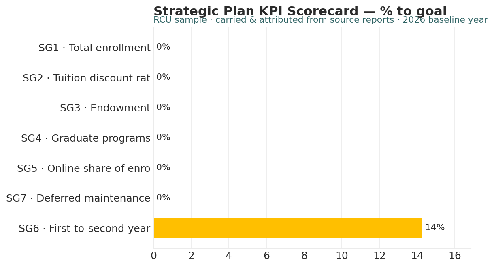

# Strategic Plan KPI Scorecard

*Higher Ed AI Cookbook · Recipe · Free to use*

A reusable AI recipe that assembles your strategic goals into a quantitative scorecard — baseline, current, target, % to goal, and on/off-track status — reading across your other reports. It is the numeric complement to the Board/Cabinet Brief, and it carries figures with their sources.

## What this recipe does

You give an AI assistant your strategic plan and the figures from your other reports, plus the agent instructions in this recipe. It returns a one-look scorecard:

- KPI Scorecard — each goal with baseline, current, target, % to goal, and status.

- Sources — where each carried figure comes from.

- Sources & Methodology — the rules and limits.

## Who it’s for

Presidents, cabinets, and boards who want the strategic plan on one quantitative page.

## What’s in the recipe

- README (this file) — orients a human, configures the agent, onboards a contractor.

- Agent Instructions — the prompt you paste into the AI tool.

- Sample Output — a fully worked example on a fictional institution, so you see the finished shape.

- Input Template — the expected columns, accepted header aliases, and an example row.

## How to run it

1.  Provide your strategic plan (goal, baseline, target) and the current figure for each goal from your reports.

2.  Shape it using the Input Template. A current value not yet available is flagged, not invented.

3.  Open your AI assistant, paste the Agent Instructions, and attach your filled template.

4.  Review the scorecard against the Sample Output. Drill into the source recipe before acting on any KPI.

5.  Decide — the scorecard summarizes; the underlying analysis informs the decision.

## Configuration — the knobs that make it yours

Defaults are set for a small institution. Override in the Input Template’s Config tab if your scale differs:

- On-track threshold: ≥ 50% to goal

- Goals: SG1–SG7 (edit to your plan)

- Direction: higher- or lower-is-better per goal

- As-of: reporting period

## What it deliberately does NOT do

- It doesn’t set targets or reallocate resources — those are governance decisions.

- It doesn’t invent a current value; a missing figure is flagged.

- It doesn’t replace the underlying analysis — a KPI is a summary.

- It carries figures with attribution; it doesn’t restate them without a source.

## /help

If you are holding this recipe with no author in the room, here is the orientation:

- help — what this is: a KPI recipe that assembles strategic goals into a quantitative scorecard with % to goal and status.

- help inputs — what it needs: a strategic plan and current figures from your reports (the Input Template shows the shape).

- help outputs — what it gives: a three-tab scorecard; the source of truth is the underlying reports, which it cites.

- help trust — how far to lean on it: figures are carried and attributed; interpretive notes are \[J\] unless a source recipe supplies \[R\]/\[I\]. It assembles — drill into the source before acting.

Built by Renee Handy · Higher Ed AI Cookbook · build 2026-07. The human-legible source of truth is the underlying source reports it cites, not any hidden state. Before you trust this agent with a real decision, find a competent human — the president’s office or the board — and have them check the read against your institution’s reality. An orphaned agent should point you at a person, not at itself.

*License: CC BY-NC-SA 4.0. Free to use and adapt for noncommercial purposes, including at your own institution. Commercial / white-label rights: contact the Cookbook. Sample data is fictional.*

## Sample output

---

## Files in this recipe

- [`KPI_Agent_Instructions.docx`](KPI_Agent_Instructions.docx)
- [`KPI_Input_Template.xlsx`](KPI_Input_Template.xlsx)
- [`KPI_README.docx`](KPI_README.docx)
- [`KPI_Sample_Output.xlsx`](KPI_Sample_Output.xlsx)

- [`fig_18_kpi_scorecard.png`](fig_18_kpi_scorecard.png)

*This page is generated from the README `.docx`, which remains the source of truth.*
