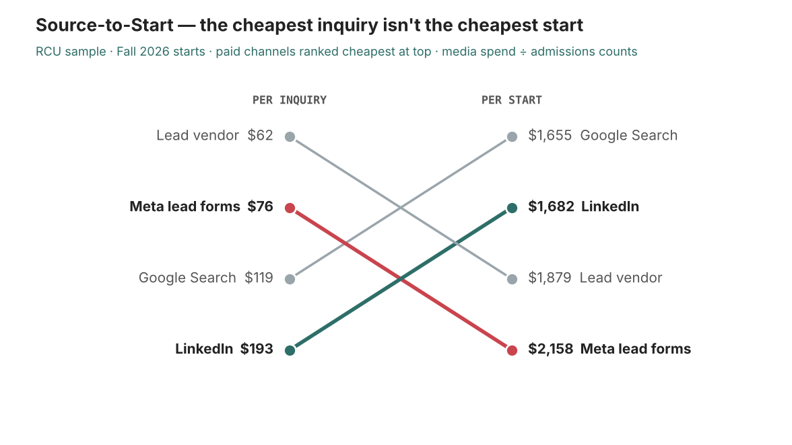

# Source-to-Start Reconciliation

*Higher Ed AI Cookbook · Recipe · CC BY-NC-SA 4.0*

A reusable AI recipe that joins what marketing paid for with what admissions recorded: cost per inquiry, application and start by channel, plus a month-by-month audit of the tracking in between. Every funnel stage gets one named source of record, so a number nobody can trace doesn't get to look like a fact.

## What this recipe does

You give an AI assistant your media spend, an aggregated admissions export, the list of source codes and the channel each belongs to, and (ideally) monthly platform counts. It returns a workbook marketing and enrollment leaders can act on:

- Cost per Stage — spend, inquiries, applications, starts, and the cost of each, by channel and segment. A channel with too few starts isn't priced per start.

- Tracking Audit — platform count against admissions count, by channel and month. It separates breaks (a run of bad months) from patterns (a steady gap every month).

- Attribution Coverage — the share of starts traced to a channel, with an optional, labelled estimate for starts whose source was lost.

- Fact Sources — the one source of record for each stage, who keeps it, and the checks that tie the numbers together.

- Recommendations — prioritized actions, each tagged research-backed, industry-practice, or analyst-judgment.

- Sources & Methodology, and a Pre-flight Check of what the exports actually contained.

## Who it’s for

Marketing directors, enrollment VPs and the one analyst at a small institution who gets asked whether the ad money is working. Especially useful where the CRM and the ad platforms have never been reconciled, or where an agency's reports are the only view of results.

## What’s in the recipe

- README (this file) — orients a human, configures the agent, onboards a contractor.

- Agent Instructions — the prompt you paste into the AI tool.

- Sample Output — a fully worked example on a fictional institution, so you see the finished shape.

- Input Template — the expected columns, accepted header aliases, and an example row.

## How to run it

1.  Pull one cycle of media spend from billing, and an admissions export of inquiries, applications and starts by source code and segment. Counts only.

2.  List every admissions source code and the channel it belongs to. Leave a code blank if nobody knows; the recipe flags it instead of guessing.

3.  If you can, add monthly platform counts (form submissions, lead-form exports, vendor invoices) next to admissions counts for the same channels.

4.  Open your AI assistant, paste the Agent Instructions, attach your filled template, and confirm the pre-flight findings before the analysis runs.

5.  Review the workbook against the Sample Output. Take the tracking findings to whoever owns the website and the CRM before you take the cost figures to anyone else.

## Configuration — the knobs that make it yours

Defaults are set for a small institution. Override in the Input Template’s Config tab if your scale differs:

- Tolerance: a 10% gap between platform and admissions counts before a month is flagged

- Minimum difference: 3 inquiries, so a tiny month doesn't trip the flag

- Fewest starts to price a channel: 10

- Attribution rule: whatever your CRM records. Name it (first touch, last touch, application source)

- Unattributed estimate: off. On shares lost-source starts across website-form channels, labelled as judgment

- Scope: segments or programs recruited with media (exclude the ones that aren't)

## One source per stage

The recipe applies the Cookbook's fact-source-per-control-axis pattern to the funnel. Spend comes from billing, starts from the registrar's census, and inquiries and applications from the admissions CRM. Platform counts are a second witness for inquiries, and that second witness is what makes the tracking audit possible. The crosswalk is the one place marketing and admissions have to agree, so the recipe treats it as a source in its own right.

## What it deliberately does NOT do

- It doesn’t set budgets or cut channels. It prices them; leadership decides.

- It doesn’t build a multi-touch attribution model. It uses the CRM's rule and says which one.

- It doesn’t read student-level records. Counts and dollar totals only, and it refuses rows with names or IDs.

- It doesn’t fill a gap with a guess. An unmapped code stays unmapped, and an estimate is labelled and shown beside the recorded figure, never in place of it.

- It doesn’t count staff time, events or the website in cost per start. The figure compares channels; it isn't the full cost of a student.

## /help

If you are holding this recipe with no author in the room, here is the orientation:

- help — what this is: a reconciliation recipe that joins media spend, platform counts and an aggregated admissions export, and returns cost per stage by channel plus a tracking audit.

- help inputs — what it needs: spend by channel, admissions counts by source code, the crosswalk, and (recommended) monthly platform counts (the Input Template shows the shape).

- help outputs — what it gives: a seven-tab workbook plus its source tabs; the human-legible source of truth is that workbook, not any hidden state.

- help trust — how far to lean on it: recommendations are labelled \[R\]/\[I\]/\[J\]; estimates are labelled and shown as a range. Cost per start is only as good as the source codes, which is why the audit comes first.

Built by Renee Handy · Higher Ed AI Cookbook · build 2026-11. The human-legible source of truth is the returned workbook, not any hidden state. Before you trust this agent with a real decision, find a competent human — a director of admissions and whoever owns the ad accounts — and have them check the read against your institution’s reality. An orphaned agent should point you at a person, not at itself.

*License: CC BY-NC-SA 4.0. Use and adapt it for your own institution with credit, and share adaptations under the same terms. Commercial use, white-label, or resale requires permission — contact the Cookbook. Sample data is fictional.*

## Sample output

**[Try the interactive demo](https://rjoy28.github.io/higher-ed-ai-cookbook/demos/rcu-source-to-start/)**: the same sample cycle, with the estimate, the segment split and the audit thresholds as controls.

---

## Files in this recipe

- [`S2S_Agent_Instructions.docx`](S2S_Agent_Instructions.docx)
- [`S2S_Input_Template.xlsx`](S2S_Input_Template.xlsx)
- [`S2S_README.docx`](S2S_README.docx)
- [`S2S_Sample_Output.xlsx`](S2S_Sample_Output.xlsx)

- [`fig_19_source_to_start.png`](fig_19_source_to_start.png)

*This page is generated from the README `.docx`, which remains the source of truth.*
