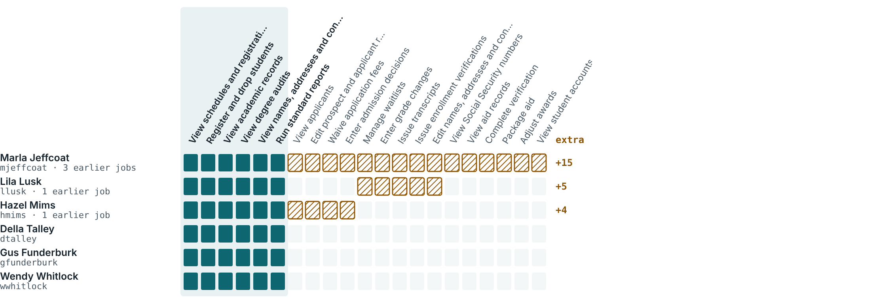

# RCU Access Review

*Higher Ed AI Cookbook · Test Kitchen · CC BY-NC-SA 4.0*

Staff access in a fictional university's student information system, in one YAML file: the HR export, the SIS security user list, grants made outside a job, and the permission pairs no one person should hold. One page proposes a role for each job from the access its people share, then lists every account that doesn't fit, with the evidence.

**[Open the live demo](https://rjoy28.github.io/higher-ed-ai-cookbook/demos/rcu-access-review/)**

## What it shows

- **Access kept from earlier jobs.** 13 of 68 active staff hold access from a job they no longer do. One advisor has had four jobs since 2008 and holds the access from all four, including grade changes and aid adjustments.
- **People who left.** Six accounts belong to people HR says have left. One is the registrar who retired in 2021. One signed in two weeks after its owner was gone. Staff sign in to the SIS with local passwords, so the job that closes accounts at separation never reaches it.
- **Conflicts.** Three people hold both halves of a conflicting pair. One was promoted from cashier and can now change where a refund goes and send it. One is an aid counselor who kept refund access from a student accounts job: two ordinary jobs added up to a conflict.
- **What a threshold does.** Raise the share of a job who must hold a permission from 75% to 90%. One new hire without aid packaging pulls packaging out of the counselor role, and the experienced counselors suddenly look like they hold extra. A stricter threshold isn't a more careful review. It's a different definition of the job.
- **What needs a person.** A one-person veterans' certifying office, a cover grant whose vacancy has since been filled, and a shared front-desk login can't be settled from the record. The page marks them and stops.

## The source file

[`rcu-access-review.yaml`](rcu-access-review.yaml) holds the HR export, the SIS security user list, grants, modules and the offices that own them, conflict rules, the fact source for each question, and the events that explain the flags. The page proposes and flags. It never removes access.

## One source per question

The demo applies the [fact source per control axis](../../patterns/fact-source-per-control-axis.md) pattern to internal control. HR answers who should have access, the security user list answers who does, and the access-request log answers why. Nobody keeps what each job should hold. That gap is what the proposed roles start to fill.

*Riverside Christian University is a fictional fixture institution. Synthetic data. Writing and data CC BY-NC-SA 4.0; code MIT.*
