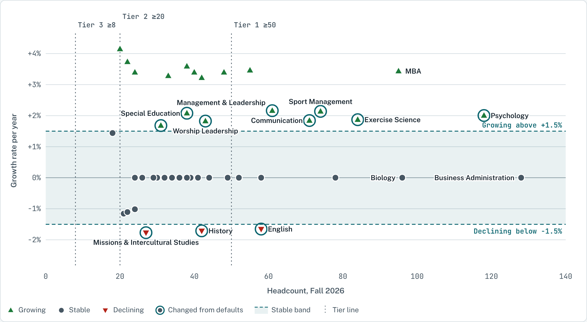

# RCU Portfolio Explorer

*Higher Ed AI Cookbook · Test Kitchen · CC BY-NC-SA 4.0*

Five years of program enrollment at a fictional university, in one YAML file. A single page renders it as a portfolio scorecard and a school rollup, with the Academic Portfolio Analyst recipe's thresholds as live controls.

**[Open the live demo](https://rjoy28.github.io/higher-ed-ai-cookbook/demos/rcu-portfolio/)**

## What it shows

- **Scorecard.** Every program plotted by headcount and growth rate, with the Stable band and tier lines drawn in. Move a threshold and the programs reclassify. A list shows which programs changed label or tier compared with the recipe defaults, and why.
- **Thresholds as policy.** At the recipe defaults, RCU has no Declining programs. Tighten the trend band to ±1.5% and three programs become Declining and eight become Growing. The data did not change. The labels are settings someone chose, and the page makes that visible.
- **Schools.** The rollup shows what no single program shows: graduate programs hold 20% of enrollment but produced about two-thirds of the five-year gain. It also lists programs in quiet decline inside the Stable band, and the largest shares of enrollment against the concentration lines.
- **Source.** Edit the YAML on the page and every view redraws.

## What it does not do

It applies the recipe's rules and shows where they land. It does not recommend Grow, Maintain, Restructure, or Sunset. In the recipe, an AI assistant drafts those with evidence-basis tags, and people decide.

## Files

- [`rcu-portfolio.yaml`](rcu-portfolio.yaml): the source, with schema notes and the rules the page applies.
- [Live demo](https://rjoy28.github.io/higher-ed-ai-cookbook/demos/rcu-portfolio/) and its [page source](../../docs/demos/rcu-portfolio/index.html).
- The recipe: [Academic Portfolio Analyst](../../01_AcademicPortfolioAnalyst/).

## The pattern

See [One source, many views](../../patterns/one-source-many-views.md). Here the source is the recipe's Input Template, and the settings live in the same file as the data so a reader can see both.

*Riverside Christian University is a fictional fixture institution. Its data is synthetic and matches the recipe's sample output. Status: Test Kitchen, expect changes.*
