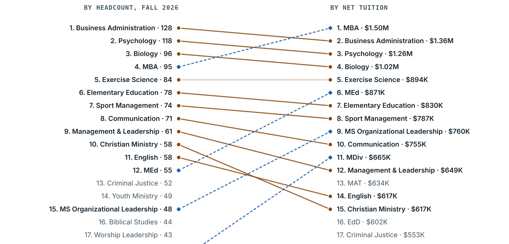

# RCU Program Economics

*Higher Ed AI Cookbook · Test Kitchen · CC BY-NC-SA 4.0*

Three recipe inputs that usually sit apart, joined in one YAML file: program enrollment, tuition and aid by segment, and the fall section schedule. One page renders them as revenue by program and teaching load by program. The rules that make the join work are live controls.

**[Open the live demo](https://rjoy28.github.io/higher-ed-ai-cookbook/demos/rcu-economics/)**

## What it shows

- **Revenue.** Net tuition by program, allocated from the segment totals so it reconciles to the aid summary. Graduate programs hold 20% of headcount and 28% of net tuition. The MBA is the fourth-largest program and brings in the most net tuition. Nine programs climb five or more places when ranked by revenue instead of size, and all nine are graduate programs.
- **Sticker price and net tuition.** Since Fall 2022 the undergraduate sticker price rose 8.6%, but net tuition per undergraduate rose only 1.3%. The discount went from 62.5% to 65.0% and absorbed most of the increase.
- **Teaching load.** Each program's share of enrolled seats in this term's sections, set against its share of net tuition. Chemistry teaches 5.3% of seats and brings in 1.5% of revenue, which is the usual pattern for a service department.
- **Gaps in the join.** The section export joins to 35 of 44 programs. Seven of the ten graduate programs have no sections on record. The subject map carries its own notes, for example that MAT means Mathematics in the schedule but the Master of Arts in Teaching in the catalog.
- **Source.** Edit the YAML on the page and every view redraws. If program headcounts stop adding up to the aid summary, the page says so.

## The rules are settings

Aid is reported by segment, not by program. By default every program in a segment gets the segment's discount rate. You can give online students their own rate, and the page then solves the campus rate so the segment's total aid still adds up. Moving that rate reorders the programs without changing any of the data. The page keeps this visible on purpose, so readers can tell a finding from an allocation.

## What it does not do

It has no cost data. Seat share is not cost, and net tuition per program is an allocation. The page shows where revenue and teaching sit and which rules put them there. It does not say which programs pay for themselves. A real version needs the full term schedule, credit hours by major, and instructional cost, all in the same source file.

## Files

- [`rcu-economics.yaml`](rcu-economics.yaml): the source, with schema notes and the rules the page applies. The live page embeds an identical copy, and [`docs/demos/rcu-economics/rcu-economics.yaml`](../../docs/demos/rcu-economics/rcu-economics.yaml) is a third. Keep all three the same.
- [Live demo](https://rjoy28.github.io/higher-ed-ai-cookbook/demos/rcu-economics/) and its [page source](../../docs/demos/rcu-economics/index.html).
- The recipes: [Academic Portfolio Analyst](../../01_AcademicPortfolioAnalyst/), [Course Section Viability](../../16_CourseSectionViability/), [Net Tuition & Discount](../../17_NetTuitionDiscount/).

## The pattern

See [One source, many views](../../patterns/one-source-many-views.md). In this demo the source joins three recipe inputs, and the join itself (the subject map and the allocation rule) sits in the same file as the data.

*Riverside Christian University is a fictional fixture institution. Its data is synthetic and matches the sample outputs of recipes 01, 16 and 17. Status: Test Kitchen, expect changes.*
