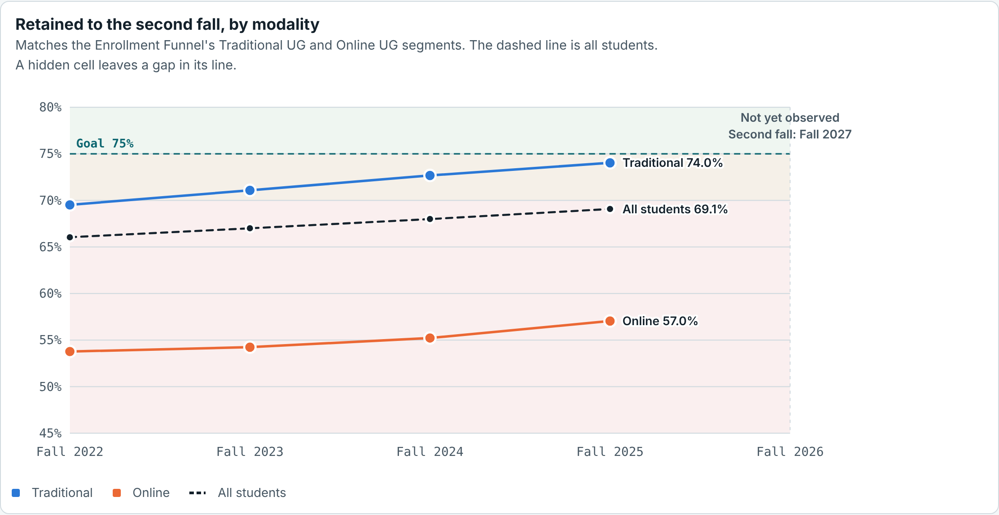

# RCU Retention Risk

*Higher Ed AI Cookbook · Test Kitchen · CC BY-NC-SA 4.0*

Four entry cohorts at a fictional university, in one YAML file: first-year retention, the same cohorts split by student group, and first-year grades in gateway courses. One page renders them as a cohort scorecard, a group comparison, and a gateway-course trace. Every number is a group total.

**[Open the live demo](https://rjoy28.github.io/higher-ed-ai-cookbook/demos/rcu-retention/)**

## What it shows

- **Cohort scorecard.** Retention to the second fall rose from 66.0% (Fall 2022) to 69.1% (Fall 2025), against a 75% goal. Fall 2025 needed 31 more students to return to reach it. Fall 2026 isn't counted until Fall 2027, and the page doesn't estimate it. The goal and approaching bands are sliders, because a goal is a decision, not a fact about students.
- **Student groups.** Split by modality, both groups improved: traditional students by 4.5 points to 74.0%, online students by 3.3 points to 57.0%. All students rose only 3.0 points, because online students grew from 22% to 29% of the cohort. At Fall 2022's mix, Fall 2025 would have retained 70.3%. The first-generation gap narrowed from 10.8 points to 7.2.
- **Small groups stay hidden.** International students number fewer than 10 in every cohort, so their retention isn't shown. Showing every other group would let anyone recover it by subtraction, so out-of-state students are hidden too. Combining small groups folds them together and shows both. The smallest reportable group is a slider.
- **Gateway courses.** Gateway DFW fell from 14.5% to 12.6%, and nearly all of it is MATH 110, which moved to a corequisite model in Fall 2024. Without MATH 110 the rate barely moved. CHEM 111 is going the other way after losing a lab instructor.

## The source file

[`rcu-retention.yaml`](rcu-retention.yaml) holds the cohort table, four dimensions, six gateway courses, and two recorded events. The page checks that every split adds up to its cohort row and that gateway grades reconcile to the cohort DFW rate. Edit the YAML in the page's Source file drawer to add a cohort, a group, or a course.

The data matches the sample output of the [Retention Risk Analyst](../../11_RetentionRisk/) recipe, and the Fall 2026 modality split matches the [Enrollment Funnel](../../05_EnrollmentFunnel/) recipe's new traditional and online undergraduates.

## Why there are no student rows

The recipe works at the cohort level by design. It never accepts or produces student rows, risk scores, or predictions about who will leave, which keeps the work out of individual education records under FERPA. The page applies the same rule to what it displays: a group too small to report is hidden, along with whatever would let someone work it out.

*Riverside Christian University is a fictional fixture institution. Synthetic data. Writing and data CC BY-NC-SA 4.0; code MIT.*
