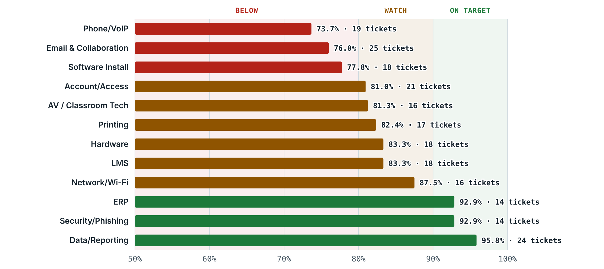

# RCU IT Service Health

*Higher Ed AI Cookbook · Test Kitchen · CC BY-NC-SA 4.0*

Six months of help-desk tickets at Riverside Christian University, scored against their service-level targets. The source file holds the export exactly as it arrived, the pre-flight decisions a person confirmed, and the SLA bands. One page renders every view from it.

**[Open the live demo](https://rjoy28.github.io/higher-ed-ai-cookbook/demos/rcu-service-health/)**

## What it shows

- **Service health.** The desk resolved 83.6% of 220 tickets within SLA, against a 90% target. Phone/VoIP, Email & Collaboration, and Software Install are below target. Reaching 90% overall would take 14 more tickets closed inside SLA. The bands are sliders, because a band is a choice, not a fact about the tickets.
- **Priority and team.** P3, the largest priority band at 107 tickets, is 13 tickets short of target, the most of any priority. The gap sits in routine work, not in emergencies.
- **Monthly trend.** Volume peaks in March and April. No month reaches 90%.
- **Pre-flight check.** The export arrived with 226 rows, and 23 of them needed a decision before scoring: duplicates from the night the LMS went down, open tickets, times logged in minutes by the phone-intake form, old labels, and odd month formats. Each check is a switch. Scored as received, attainment reads 81.9%, the category list grows from 12 to 14, and four categories change status. Network/Wi-Fi would look on target only because two of its missed tickets are filed under an old name.
- **Behind the page.** Open the Source file drawer below the views, edit the YAML, and every view redraws. Build notes live there too, so the views hold only findings ([content first, machinery behind](../../patterns/content-first.md)).

## Flag, confirm, then score

The page finds problems in the export on its own, but it fixes only what a person confirmed. Time values that look like minutes are flagged, and only the rows listed as confirmed in the source file are converted. Labels map only through the alias list. Everything else stays flagged. This is the recipe's pre-flight rule: nothing is dropped silently or guessed.

## What it does not do

It doesn't diagnose root cause. A low category shows where to look, not why. It reads no ticket text and no requester details, only category-level operational fields.

## Files

- [`rcu-service-health.yaml`](rcu-service-health.yaml): the source, with schema notes and the rules the page applies. The live page embeds an identical copy, and [`docs/demos/rcu-service-health/rcu-service-health.yaml`](../../docs/demos/rcu-service-health/rcu-service-health.yaml) is a third. Keep all three the same.
- [Live demo](https://rjoy28.github.io/higher-ed-ai-cookbook/demos/rcu-service-health/) and its [page source](../../docs/demos/rcu-service-health/index.html).
- The recipe: [IT Service Health Analyst](../../02_ITServiceHealth/).

*Riverside Christian University is a fictional fixture institution. Its data is synthetic and matches the IT Service Health Analyst's sample output, including its Pre-flight Check. Status: Test Kitchen, expect changes.*
