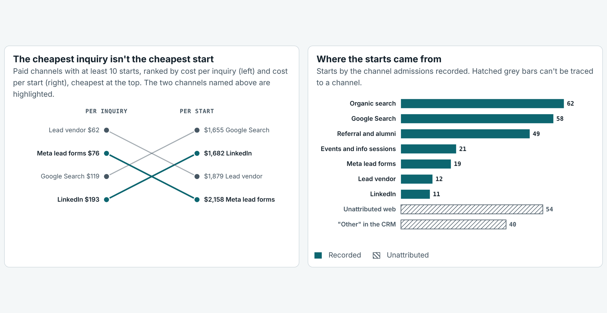

# RCU Source-to-Start Reconciliation

*Higher Ed AI Cookbook · Test Kitchen · CC BY-NC-SA 4.0*

One recruiting cycle at a fictional university, in one YAML file: what marketing paid for, what admissions recorded by source code, the crosswalk between them, and twelve months of platform counts set against admissions counts. One page renders them as cost per start by channel, a month-by-month tracking audit, and a ledger of where each number comes from. Every number is a count or a dollar total.

**[Open the live demo](https://rjoy28.github.io/higher-ed-ai-cookbook/demos/rcu-source-to-start/)**

## What it shows

- **Cost per start.** RCU spent $182,250 on media for its Fall 2026 online and graduate starts. Meta lead forms have the second-cheapest inquiry ($76) and the most expensive start ($2,158). LinkedIn is the reverse: the most expensive inquiry ($193) and the second-cheapest start ($1,682). Organic search brought more starts (62) than any paid channel.
- **Starts nobody can trace.** 94 of 326 starts (29%) can't be traced to a channel. 54 came through website forms that lost their source, and 40 are coded Other, the first entry in the CRM's source dropdown. A toggle shares the lost-source starts out across website-form channels. The page labels every figure the estimate touches, because the estimate is a judgment call. With it, Google Search drops from $1,655 to $1,146 per start.
- **Tracking audit.** In June through August, GA4 counted 384 form submissions from Google, LinkedIn and organic search, and admissions recorded 76 with those sources. In the same months admissions recorded 278 more plain-web inquiries than GA4's direct traffic explains. The refreshed program-page template had gone live without its hidden source fields. The inquiries arrived. Their source didn't.
- **A break versus a pattern.** In March, 33 Meta leads never reached admissions: a password rotation stopped the lead sync for nine days. The lead vendor, by contrast, is flagged in all twelve months, because 10–13% of the leads it invoiced were already in the CRM. That's $2,640 in credits under the contract.
- **An unmapped code.** A $4,200 YouTube pilot used a source code nobody added to the crosswalk. Map it in the Source file drawer and watch it turn into 14 inquiries and no starts.

## The source file

[`rcu-source-to-start.yaml`](rcu-source-to-start.yaml) holds spend by channel and segment, admissions counts by source code, the crosswalk, monthly platform and admissions counts, the fact source for each stage, and the events that explain the flags. The page checks that each segment's admissions rows add up to the Enrollment Funnel recipe's Fall 2026 totals, and that each channel's monthly admissions counts add up to the export.

The data matches the sample output of the [Source-to-Start Reconciliation](../../19_SourceToStart/) recipe. Its inquiries, applications and starts match the [Enrollment Funnel](../../05_EnrollmentFunnel/) recipe's Fall 2026 Online UG and Graduate segments.

## One source per stage

The recipe applies the [fact source per control axis](../../patterns/fact-source-per-control-axis.md) pattern to the funnel. Spend comes from billing, starts from the registrar's census, and inquiries and applications from the admissions CRM. Platform counts are a second witness for inquiries, which is what makes the audit possible. The crosswalk is where marketing and admissions have to agree.

*Riverside Christian University is a fictional fixture institution. Synthetic data. Writing and data CC BY-NC-SA 4.0; code MIT.*
