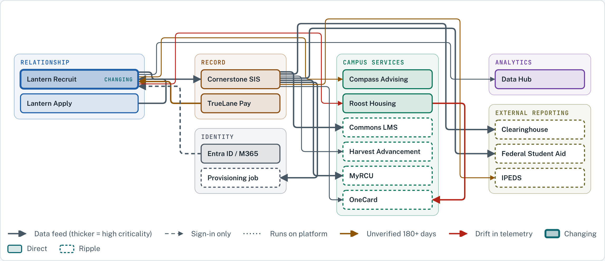

# RCU Systems Atlas

*Higher Ed AI Cookbook · Test Kitchen · Free to use*

One YAML file describes every system, interface, and owner at a fictional university. A single page renders it on demand as an impact radius, a system-of-record matrix, and a drift report.

**[Open the live demo](https://rjoy28.github.io/higher-ed-ai-cookbook/demos/rcu-atlas/)**

## What it shows

- **Impact radius.** Pick a system and see what a change touches directly (rebuild or retest) and what it ripples to (regression check), with owners to bring in and how many claims in the radius are out of date.
- **Ownership.** Which system holds the official record for each kind of data at each lifecycle stage, for students and for employees. Two systems claiming the same stage is a conflict; an interior blank is a gap. The systems list shows how people sign in to each one.
- **Drift.** The source's claims checked against telemetry snapshots: links that should run but don't, jobs that run but aren't documented, applications with no sign-in path on record, owner mismatches, and claims past their verification date.
- **Regulatory flags.** FERPA, GLBA, Title IV and IPEDS tags filter every view, down to the field.
- **Source.** Edit the YAML in the page and every view redraws.

## How links are modeled

One interface per pair of systems. Each field it carries flows from → to by default, or sets `flow: back` or `flow: both`, and can carry its own frequency, compliance and provenance. Rosters out and final grades back are one SIS ⇄ LMS link, not two.

## Files

- [`rcu-systems.yaml`](rcu-systems.yaml): the source catalog and schema notes.
- [Live demo](https://rjoy28.github.io/higher-ed-ai-cookbook/demos/rcu-atlas/) and its [page source](../../docs/demos/rcu-atlas/index.html).

## The pattern

See [One source, many views](../../patterns/one-source-many-views.md).

*Riverside Christian University is a fictional fixture institution. Its telemetry is simulated. Status: Test Kitchen, expect changes.*
